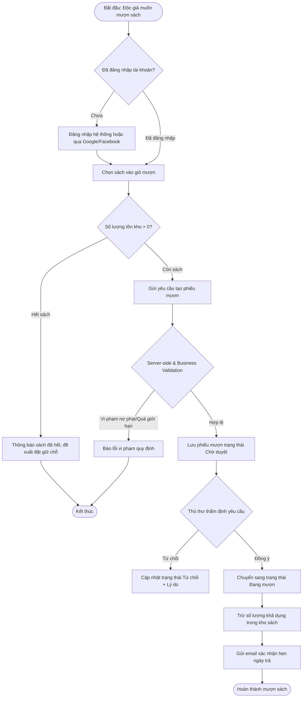
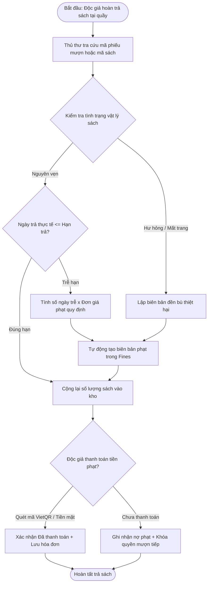
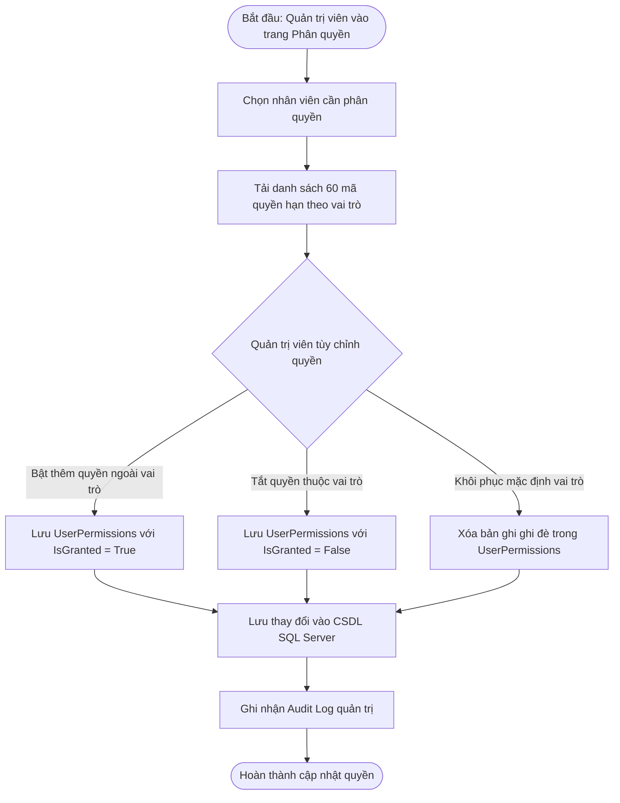
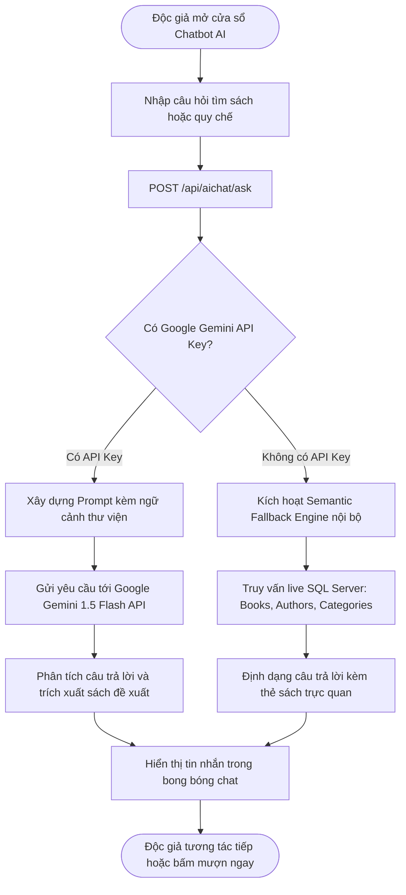

# TRƯỜNG CAO ĐẲNG FPT POLYTECHNIC
## KHOA CÔNG NGHỆ THÔNG TIN
---

# BÁO CÁO DỰ ÁN 1 (MÔN HỌC SOF1022 / NET108)
## ĐỀ TÀI: XÂY DỰNG HỆ THỐNG WEBSITE QUẢN LÝ THƯ VIỆN ĐIỆN TỬ HIỆN ĐẠI
### (MODERN DIGITAL LIBRARY MANAGEMENT SYSTEM)

- **Môn học:** Dự án .NET 1 (Mã môn: SOF1022 / NET108)
- **Lớp:** SD2003
- **Nhóm thực hiện:** Nhóm 1 (NHOM 1)
- **Cơ sở dữ liệu:** `SOF1022_NHOM1_SD2003_Ver2` (Microsoft SQL Server - 33 bảng quan hệ chuẩn 3NF)
- **Nền tảng công nghệ:** ASP.NET Core 10 MVC (.NET 10), C# 13, Entity Framework Core 10.0.9, SQL Server, Bootstrap 5.3, OAuth2, SignalR, Google Gemini AI 1.5 Flash
- **Năm thực hiện:** 2026 - 2027

---

## LỜI CẢM ƠN

Lời đầu tiên, nhóm tác giả xin gửi lời cảm ơn chân thành và sâu sắc nhất đến Ban Giám hiệu Trường Cao đẳng FPT Polytechnic, quý Thầy/Cô Khoa Công nghệ Thông tin đã tạo điều kiện học tập thuận lợi và truyền đạt những kiến thức quý báu về nền tảng lập trình .NET, phân tích thiết kế hệ thống và quy trình phát triển phần mềm hiện đại.

Đặc biệt, nhóm xin gửi lời cảm ơn sâu sắc nhất tới **Giảng viên hướng dẫn môn học Dự án .NET 1 (SOF1022)** đã luôn tận tình chỉ dẫn, đóng góp những ý kiến chuyên môn xác đáng, định hướng giải pháp kỹ thuật và động viên nhóm trong suốt quá trình hoàn thiện đề tài. Những lời nhận xét của Thầy/Cô không chỉ giúp hệ thống hoàn thiện về mặt chức năng mà còn giúp nhóm rèn luyện tư duy lập trình chuyên nghiệp, cách tổ chức mã nguồn chuẩn mực và kỹ năng giải quyết vấn đề thực tế.

Mặc dù đã rất nỗ lực để hoàn thành hệ thống với tiêu chuẩn cao nhất, song do thời gian và kiến thức có hạn, đề tài khó tránh khỏi những thiếu sót nhất định. Nhóm rất mong tiếp tục nhận được những ý kiến đóng góp quý báu từ quý Thầy/Cô và các bạn để hệ thống ngày càng hoàn thiện hơn.

*Nhóm 1 - Lớp SD2003 trân trọng cảm ơn!*

---

## LỜI CAM ĐOAN

Nhóm 1 - Lớp SD2003 xin cam đoan:
1. Đề tài báo cáo *"Xây dựng hệ thống website quản lý thư viện điện tử hiện đại"* là công trình nghiên cứu và thực hiện độc lập của các thành viên trong nhóm dưới sự hướng dẫn của Giảng viên bộ môn.
2. Toàn bộ mã nguồn chương trình, cơ sở dữ liệu (`SOF1022_NHOM1_SD2003_Ver2`), cấu trúc giao diện, tài liệu đặc tả và số liệu thực nghiệm được xây dựng trung thực dựa trên yêu cầu thực tế của môn học.
3. Mọi tài liệu tham khảo, thư viện mã nguồn mở và hình ảnh sử dụng trong dự án đều được trích dẫn rõ ràng theo đúng quy định học thuật.

*Đại diện Nhóm thực hiện:* **Nhóm 1 - Lớp SD2003**

---

## KẾ HOẠCH THỰC HIỆN DỰ ÁN

| STT | Tuần / Giai đoạn | Nội dung công việc thực hiện | Sản phẩm bàn giao | Ghi chú |
| :---: | :---: | :--- | :--- | :---: |
| 1 | Tuần 1 (Lab 1) | Khảo sát nhu cầu thực tế, xác định phạm vi đề tài, thiết lập sơ đồ Use Case tổng quan và phân quyền Actor. | Tài liệu đặc tả yêu cầu, file `SoDo_UseCase_HeThong.drawio`. | Hoàn thành |
| 2 | Tuần 2 (Lab 2) | Thiết kế mô hình dữ liệu quan hệ (ERD Level 2), thiết kế sơ đồ luồng màn hình UI Flow và sơ đồ cấu trúc Site Map. | File `SoDo_ERD_CoSoDuLieu.drawio`, `SoDo_LuongGiaoDien_UIFlow.drawio`. | Hoàn thành |
| 3 | Tuần 3 (Lab 3) | Khởi tạo CSDL SQL Server chuẩn 3NF, thiết lập DbContext, nạp dữ liệu mẫu (Seed Data) chuẩn hóa và cấu hình ORM EF Core. | Script SQL 31 bảng quan hệ, `LibraryDbContext.cs`, `SeedData.cs`. | Hoàn thành |
| 4 | Tuần 4 (Lab 4) | Xây dựng các phân hệ danh mục cơ bản (Tác giả, Danh mục, Nhà xuất bản, Sách) và cơ chế xác thực Cookie & Session. | Controllers, ViewModels, Views CRUD hoàn chỉnh. | Hoàn thành |
| 5 | Tuần 5 (Lab 5) | Xây dựng phân hệ nghiệp vụ mượn - trả sách (BorrowSlips, BorrowDetails), xử lý logic tự động tính toán thời hạn, quản lý kho kệ lưu trữ. | `BorrowSlipsController`, `ShelvesController`, phân hệ duyệt phiếu. | Hoàn thành |
| 6 | Tuần 6 (Lab 6) | Xây dựng phân hệ xử lý vi phạm, biên bản phạt quá hạn/hư hỏng (Fines), trung tâm hỗ trợ trực tuyến và hệ thống thông báo. | `FinesController`, `SupportTicketsController`, `NotificationsController`. | Hoàn thành |
| 7 | Tuần 7 (Lab 7) | Kiểm thử chức năng toàn diện (Functional Testing, Unit Testing), thiết kế bộ Test Cases, tối ưu giao diện Light/Dark Mode, chống cắt chữ UI. | Bảng Test Cases (12 ca kiểm thử trọng yếu), fix triệt để lỗi CSS/Layout. | Hoàn thành |
| 8 | Tuần 8 (Lab 8) | Thiết kế kiến trúc 3 lớp MVC, tích hợp tiện ích nâng cao (AI, OAuth Google/Facebook, Export Excel), đóng gói và triển khai. | File `SoDo_KienTruc_3Lop_MVC.drawio`, tài liệu Báo cáo đồ án hoàn chỉnh. | Hoàn thành |

---

## MỤC LỤC

- [PHẦN MỞ ĐẦU](#phần-mở-đầu)
  - [1.1. Tính cấp thiết của đề tài](#11-tính-cấp-thiết-của-đề-tài)
  - [1.2. Mục tiêu của đề tài](#12-mục-tiêu-của-đề-tài)
  - [1.3. Đối tượng và phạm vi nghiên cứu](#13-đối-tượng-và-phạm-vi-nghiên-cứu)
  - [1.4. Phương pháp nghiên cứu](#14-phương-pháp-nghiên-cứu)
- [CHƯƠNG 1: CƠ SỞ LÝ THUYẾT & CÔNG NGHỆ ÁP DỤNG](#chương-1-cơ-sở-lý-thuyết--công-nghệ-áp-dụng)
  - [1.1. Nền tảng Microsoft .NET 8 và ngôn ngữ C#](#11-nền-tảng-microsoft-net-8-và-ngôn-ngữ-c)
  - [1.2. Mô hình kiến trúc ASP.NET Core MVC](#12-mô-hình-kiến-trúc-aspnet-core-mvc)
  - [1.3. Entity Framework Core (EF Core) và Code-First](#13-entity-framework-core-ef-core-và-code-first)
  - [1.4. Hệ quản trị cơ sở dữ liệu Microsoft SQL Server](#14-hệ-quản-trị-cơ-sở-dữ-liệu-microsoft-sql-server)
  - [1.5. Công nghệ giao diện người dùng hiện đại](#15-công-nghệ-giao-diện-người-dùng-hiện-đại)
  - [1.6. Cơ chế xác thực, bảo mật và phân quyền đa cấp](#16-cơ-chế-xác-thực-bảo-mật-và-phân-quyền-đa-cấp)
  - [1.7. Dịch vụ mở rộng: Email SMTP, Tích hợp AI và Xuất báo cáo Excel](#17-dịch-vụ-mở-rộng-email-smtp-tích-hợp-ai-và-xuất-báo-cáo-excel)
- [CHƯƠNG 2: KHẢO SÁT HIỆN TRẠNG VÀ PHÂN TÍCH YÊU CẦU](#chương-2-khảo-sát-hiện-trạng-và-phân-tích-yêu-cầu)
  - [2.1. Khảo sát hiện trạng quản lý thư viện](#21-khảo-sát-hiện-trạng-quản-lý-thư-viện)
  - [2.2. Phân tích yêu cầu chức năng (Functional Requirements)](#22-phân-tích-yêu-cầu-chức-năng-functional-requirements)
  - [2.3. Phân tích yêu cầu phi chức năng (Non-Functional Requirements)](#23-phân-tích-yêu-cầu-phi-chức-năng-non-functional-requirements)
  - [2.4. Lược đồ Use Case tổng quát và phân rã các Actors](#24-lược-đồ-use-case-tổng-quát-và-phân-rã-các-actors)
  - [2.5. Bảng đặc tả Use Case chi tiết](#25-bảng-đặc-tả-use-case-chi-tiết)
- [CHƯƠNG 3: THIẾT KẾ HỆ THỐNG](#chương-3-thiết-kế-hệ-thống)
  - [3.1. Kiến trúc hệ thống tổng thể (System Architecture)](#31-kiến-trúc-hệ-thống-tổng-thể-system-architecture)
  - [3.2. Sơ đồ luồng giao diện (UI Flow & Site Map)](#32-sơ-đồ-luồng-giao-diện-ui-flow--site-map)
  - [3.3. Thiết kế cơ sở dữ liệu chi tiết (Database Design)](#33-thiết-kế-cơ-sở-dữ-liệu-chi-tiết-database-design)
  - [3.4. Sơ đồ tuần tự (Sequence Diagrams) cho các nghiệp vụ chính](#34-sơ-đồ-tuần-tự-sequence-diagrams-cho-các-nghiệp-vụ-chính)
- [CHƯƠNG 4: HIỆN THỰC VÀ KIỂM THỬ HỆ THỐNG](#chương-4-hiện-thực-và-kiểm-thử-hệ-thống)
  - [4.1. Môi trường phát triển và công cụ sử dụng](#41-môi-trường-phát-triển-và-công-cụ-sử-dụng)
  - [4.2. Hiện thực các phân hệ chức năng tiêu biểu](#42-hiện-thực-các-phân-hệ-chức-năng-tiêu-biểu)
  - [4.3. Kế hoạch và kết quả kiểm thử (Software Testing)](#43-kế-hoạch-và-kết-quả-kiểm-thử-software-testing)
- [PHẦN KẾT LUẬN VÀ HƯỚNG PHÁT TRIỂN](#phần-kết-luận-và-hướng-phát-triển)
  - [5.1. Kết quả đạt được](#51-kết-quả-đạt-được)
  - [5.2. Đánh giá ưu điểm và hạn chế](#52-đánh-giá-ưu-điểm-và-hạn-chế)
  - [5.3. Hướng phát triển trong tương lai](#53-hướng-phát-triển-trong-tương-lai)
- [TÀI LIỆU THAM KHẢO](#tài-liệu-tham-khảo)

---

## DANH MỤC BẢNG BIỂU

- Bảng 1: Bảng kế hoạch thực hiện dự án theo tuần
- Bảng 2: Phân loại quyền hạn của các nhóm tác nhân (Actors)
- Bảng 3: Đặc tả Use Case UC-01 (Đăng nhập hệ thống)
- Bảng 4: Đặc tả Use Case UC-02 (Đăng ký tài khoản độc giả)
- Bảng 5: Đặc tả Use Case UC-03 (Tìm kiếm & Lọc sách nâng cao)
- Bảng 6: Đặc tả Use Case UC-04 (Lập phiếu mượn sách trực tuyến)
- Bảng 7: Đặc tả Use Case UC-05 (Duyệt phiếu mượn & Trừ kho)
- Bảng 8: Đặc tả Use Case UC-06 (Xác nhận trả sách & Xử lý phạt)
- Bảng 9: Từ điển dữ liệu bảng `Books` (Sách)
- Bảng 10: Từ điển dữ liệu bảng `Shelves` (Kệ sách)
- Bảng 11: Từ điển dữ liệu bảng `Readers` (Độc giả)
- Bảng 12: Từ điển dữ liệu bảng `BorrowSlips` (Phiếu mượn)
- Bảng 13: Từ điển dữ liệu bảng `BorrowDetails` (Chi tiết phiếu mượn)
- Bảng 14: Từ điển dữ liệu bảng `Fines` & `FineDetails` (Biên bản phạt)
- Bảng 15: Ma trận 12 ca kiểm thử chức năng trọng yếu (Test Cases Matrix)

---

## DANH MỤC HÌNH VẼ

- Hình 1: Kiến trúc mô hình 3 lớp ASP.NET Core MVC (Client - Application Server - SQL Server)
- Hình 2: Sơ đồ Use Case tổng quát hệ thống Quản lý Thư viện
- Hình 3: Sơ đồ luồng giao diện người dùng (UI Flow & Site Map)
- Hình 4: Sơ đồ quan hệ thực thể cơ sở dữ liệu (ERD) 31 bảng quan hệ
- Hình 5: Sơ đồ tuần tự nghiệp vụ Lập phiếu mượn sách trực tuyến
- Hình 6: Sơ đồ tuần tự nghiệp vụ Xác nhận trả sách và phát sinh tiền phạt
- Hình 7: Giao diện Kệ Sách Tinh Hoa 3D (3D Bookshelf Perspective Flow)
- Hình 8: Giao diện Danh mục Sách và Bộ lọc 5 cột cân xứng chống cắt chữ
- Hình 9: Giao diện Chi tiết sách kèm Trích dẫn và Popup viết bình luận
- Hình 10: Giao diện Dashboard Quản trị viên (Top sách, Top độc giả, Cảnh báo quá hạn, 8 Quick Actions)
- Hình 11: Giao diện Quản lý kho Kệ sách và Thanh đo sức chứa chống quá tải

---

# PHẦN MỞ ĐẦU

### 1.1. Tính cấp thiết của đề tài
Trong kỷ nguyên cách mạng công nghiệp 4.0 và xu hướng chuyển đổi số mạnh mẽ trong giáo dục, thư viện trường học không còn đơn thuần là một kho chứa sách vật lý mà đã trở thành trung tâm tài nguyên tri thức cốt lõi. Tuy nhiên, tại nhiều cơ sở giáo dục hiện nay, công tác quản lý thư viện vẫn còn gặp nhiều bất cập:
- **Phương thức thủ công, phân tán:** Việc theo dõi sách, lập phiếu mượn, ghi sổ trả sách hay ghi nhận tiền phạt bằng sổ tay hoặc các bảng tính Excel rời rạc dẫn đến nguy cơ sai sót, nhầm lẫn số liệu và thất thoát đầu sách.
- **Thiếu tính tương tác từ xa:** Độc giả (học sinh, sinh viên, giảng viên) không thể chủ động tra cứu tình trạng sách còn hay hết trước khi đến thư viện, không thể đặt giữ chỗ hay xem trước trích dẫn tác phẩm.
- **Khó khăn trong việc kiểm kê kho:** Thủ thư mất rất nhiều thời gian để xác định cuốn sách đang nằm ở tầng nào, khu vực nào, kệ số bao nhiêu và liệu kệ sách đó có đang bị quá tải sức chứa hay không.
- **Trải nghiệm người dùng nghèo nàn:** Đa số các cổng thư viện cũ có giao diện đơn điệu, không tối ưu cho thiết bị di động, không hỗ trợ chế độ đọc ban đêm (Dark Mode) và thiếu các tính năng tương tác cộng đồng văn minh (đánh giá sao, bình luận, tích điểm huy hiệu đọc sách).

Xuất phát từ thực tiễn trên, việc nghiên cứu và xây dựng **"Hệ thống Website Quản lý Thư viện Điện tử Hiện đại"** bằng công nghệ **ASP.NET Core 8 MVC** kết hợp cơ sở dữ liệu **Microsoft SQL Server** là hết sức cấp thiết. Đề tài không chỉ đáp ứng trọn vẹn mục tiêu học thuật của môn học **Dự án .NET 1 (SOF1022)** mà còn mang tính ứng dụng thực tiễn cao, hướng tới mô hình thư viện số thông minh, trực quan và tiện ích.

### 1.2. Mục tiêu của đề tài
- **Về mặt công nghệ:** Vận dụng thành thạo nền tảng .NET 8, C#, kiến trúc MVC 3 tầng, Entity Framework Core, SQL Server, cơ chế xác thực đa kênh (OAuth Google, Facebook) và thiết kế giao diện thích ứng (Responsive Design).
- **Về mặt quản lý kho & nghiệp vụ thư viện:**
  - Tự động hóa toàn bộ quy trình: Quản lý đầu sách, phân loại thể loại, tác giả, nhà xuất bản.
  - Quản lý kệ sách thông minh: Theo dõi sức chứa tối đa, hiển thị cảnh báo trực quan khi kệ sách sắp đầy hoặc quá tải.
  - Quản lý mượn - trả chặt chẽ: Thiết lập hạn mượn linh hoạt (7, 14, 30 ngày), tự động tính toán thời gian quá hạn và phát sinh phiếu phạt tương ứng.
- **Về mặt trải nghiệm độc giả:**
  - Tích hợp **Kệ sách 3D tương tác (3D Bookshelf Hero)** tạo điểm nhấn thẩm mỹ thu hút bạn đọc.
  - Bộ lọc tìm kiếm thông minh đa tiêu chí: Tìm theo tên, tác giả, danh mục, số lượng sẵn có mà không bao giờ bị cắt chữ hay vỡ khung hình.
  - Popup viết bình luận văn minh, đọc thử trích dẫn sách kinh điển và hệ thống huy hiệu khen thưởng độc giả tích cực.

### 1.3. Đối tượng và phạm vi nghiên cứu
- **Đối tượng nghiên cứu:**
  - Quy trình nghiệp vụ quản lý thư viện truyền thống và thư viện điện tử.
  - Công nghệ lập trình Web với ASP.NET Core 8 MVC và Entity Framework Core.
  - Thiết kế kiến trúc phần mềm, mô hình dữ liệu quan hệ chuẩn hóa 3NF.
- **Phạm vi nghiên cứu:**
  - **Phân hệ Người dùng / Độc giả (Reader Portal):** Dành cho khách vãng lai và độc giả đã đăng ký (tra cứu sách, xem kệ 3D, lập phiếu mượn, theo dõi hạn trả, quản lý phiếu phạt, gửi yêu cầu hỗ trợ).
  - **Phân hệ Quản trị / Nhân viên (Admin & Staff Portal):** Dành cho thủ thư, nhân viên kho và ban quản trị (quản lý sách, danh mục, kho kệ, phê duyệt phiếu mượn, xác nhận trả sách, xử lý tiền phạt, quản lý nhân sự, xem báo cáo thống kê trực quan).

### 1.4. Phương pháp nghiên cứu
- **Phương pháp thu thập và phân tích tài liệu:** Nghiên cứu tài liệu chính thống của Microsoft, quy chuẩn đào tạo nghề CNTT của FPT Polytechnic, tham khảo các website thư viện quốc tế (Open Library, Goodreads).
- **Phương pháp phân tích và thiết kế hướng đối tượng (OOAD):** Sử dụng ngôn ngữ mô hình hóa UML để vẽ sơ đồ Use Case, Class Diagram, Sequence Diagram trên công cụ Draw.io.
- **Phương pháp phát triển phần mềm theo mô hình Agile:** Phân chia dự án thành các sprint ngắn (tương ứng với các bài Lab từ Lab 1 đến Lab 8), liên tục tích hợp, kiểm thử và tinh chỉnh phản hồi từ giảng viên.

---

# CHƯƠNG 1: CƠ SỞ LÝ THUYẾT & CÔNG NGHỆ ÁP DỤNG

### 1.1. Nền tảng Microsoft .NET 10 và ngôn ngữ C#
- **Microsoft .NET 10:** Là phiên bản hiện đại của nền tảng .NET mã nguồn mở, đa nền tảng. .NET 10 mang lại bước nhảy vọt về hiệu năng thực thi thông qua trình biên dịch JIT tối ưu, Garbage Collection thông minh, tối ưu hóa bộ nhớ Kestrel Web Server và hỗ trợ Visual Studio 2022 v17.12+.
- **Ngôn ngữ C# 13:** Ngôn ngữ lập trình hướng đối tượng mạnh mẽ, an toàn kiểu dữ liệu (Type-safe), hỗ trợ lập trình bất đồng bộ (`async`/`await`), Pattern Matching, Record Types, Primary Constructors, Nullable Reference Types giúp giảm thiểu tối đa lỗi `NullReferenceException` trong quá trình vận hành hệ thống.

### 1.2. Mô hình kiến trúc ASP.NET Core MVC
Kiến trúc MVC (Model - View - Controller) phân tách ứng dụng thành 3 thành phần độc lập:
1. **Model (Dữ liệu & Logic nghiệp vụ):** Đại diện cho các thực thể dữ liệu trong thư viện (`Books`, `BorrowSlips`, `Readers`, `Shelves`...). Model chịu trách nhiệm lưu trữ trạng thái dữ liệu và thực thi các quy tắc validation (`[Required]`, `[StringLength]`, `[Range]`).
2. **View (Giao diện hiển thị):** Sử dụng cú pháp Razor (`.cshtml`) kết hợp mã HTML5 và C# để kết xuất dữ liệu động trả về cho trình duyệt. View được thiết kế phân tầng thông qua `_Layout.cshtml`, `_ReaderLayout.cshtml` và các Partial Views tái sử dụng.
3. **Controller (Bộ điều khiển):** Đóng vai trò cầu nối tiếp nhận HTTP Request từ client, gọi các tác vụ nghiệp vụ và truy vấn dữ liệu từ Entity Framework Core, sau đó lựa chọn View phù hợp để phản hồi kết quả về cho người dùng.

### 1.3. Entity Framework Core (EF Core) và Code-First
- **Entity Framework Core:** Là công nghệ ORM (Object-Relational Mapping) hàng đầu cho .NET, cho phép lập trình viên tương tác với cơ sở dữ liệu quan hệ hoàn toàn bằng các đối tượng C# và biểu thức LINQ (Language Integrated Query) thay vì phải viết các câu lệnh SQL thô.
- **Kỹ thuật Code-First:** Định nghĩa cấu trúc bảng thông qua các class C#, sau đó sử dụng EF Core Migrations để tự động phát sinh và cập nhật lược đồ CSDL trên máy chủ SQL Server.
- **Fluent API:** Được cấu hình chuyên sâu trong phương thức `OnModelCreating` của class `LibraryDbContext.cs` để thiết lập các ràng buộc phức tạp: quan hệ 1-Nhiều giữa `BorrowSlips` và `Fines`, quan hệ giữa `FineDetails` và `Books`, cấu hình xóa hạn chế (`DeleteBehavior.Restrict`, `DeleteBehavior.NoAction`) nhằm tránh hiện tượng chuỗi xóa theo tầng (Multiple Cascade Paths) gây mất an toàn dữ liệu.

### 1.4. Hệ quản trị cơ sở dữ liệu Microsoft SQL Server
Hệ quản trị CSDL quan hệ cấp doanh nghiệp (RDBMS) mạnh mẽ, đảm bảo tính toàn vẹn dữ liệu tuân thủ nghiêm ngặt nguyên lý ACID (Atomicity, Consistency, Isolation, Durability).
- CSDL `SOF1022_NHOM1_SD2003_Ver2` được cấu hình bảng mã tiếng Việt `Vietnamese_CI_AS`.
- Tối ưu hóa hiệu năng truy vấn thông qua các chỉ mục (Index) trên các trường thường xuyên tìm kiếm và liên kết khóa ngoại: `BorrowSlipId`, `ReaderId`, `BookId`, `CategoriesId`.
- Tích hợp Stored Procedures thống kê và Trigger kiểm soát số lượng sách tự động.

### 1.5. Công nghệ giao diện người dùng hiện đại
- **Bootstrap 5.3 & CSS Variables:** Hệ thống lưới Grid System 12 cột linh hoạt, kết hợp bộ biến toàn cục CSS (`--bg-surface`, `--text-primary`, `--brand-base`, `--border-color`) cho phép quản lý màu sắc và khoảng cách đồng bộ.
- **Công nghệ chuyển đổi Light/Dark Mode thông minh:** Sử dụng thuộc tính `data-theme="dark"` trên thẻ `<html>` kết hợp `localStorage` của trình duyệt. Giao diện Dark Mode được thiết kế theo tiêu chuẩn công thái học với gam màu xám than sang trọng `#14171F`, giảm mỏi mắt cho độc giả khi đọc sách ban đêm và đảm bảo độ tương phản màu chữ đạt chuẩn WCAG AAA.
- **Cơ chế chống cắt chữ & co cụm nút bấm toàn hệ thống:** Thiết lập các quy tắc CSS cốt lõi `.btn { white-space: nowrap !important; min-width: max-content; }` và `.form-select { min-width: 120px; }` ngăn chặn hoàn toàn lỗi văn bản bị che khuất trên mọi kích thước màn hình.
- **Kệ sách Tinh hoa 3D (3D Bookshelf Perspective Flow):** Kỹ thuật biến đổi không gian 3 chiều CSS 3D Transforms (`perspective`, `rotateY`, `translateZ`) mô phỏng giá sách thực tế trong không gian ảo, mang lại trải nghiệm thị giác đột phá.

### 1.6. Cơ chế xác thực, bảo mật và phân quyền đa cấp
- **Xác thực Cookie & Session:** Phiên đăng nhập của người dùng được mã hóa và duy trì an toàn trong Cookie HTTP-only, bảo vệ phiên trước các cuộc tấn công đánh cắp phiên (Session Hijacking).
- **Tích hợp OAuth 2.0 bên thứ ba:** Hỗ trợ đăng nhập nhanh bằng tài khoản **Google** và **Facebook** thông qua các gói thư viện chuẩn `Microsoft.AspNetCore.Authentication.Google` và `Microsoft.AspNetCore.Authentication.Facebook`.
- **Hệ thống phân quyền Role-Based Access Control (RBAC):** Mô hình hóa chi tiết với 6 nhóm vai trò (Admin, Quản lý, Thủ thư, Kế toán, Nhân viên kho, Độc giả) và 60 quyền hạn thao tác riêng biệt, đảm bảo nguyên tắc đặc quyền tối thiểu (Principle of Least Privilege).

### 1.7. Dịch vụ mở rộng: Email SMTP, Tích hợp AI và Xuất báo cáo Excel
- **Gửi Email thông báo tự động (SMTP Gmail):** Tự động gửi thư điện tử chúc mừng khi đăng ký tài khoản thành công, gửi thông báo khi phiếu mượn được phê duyệt và nhắc nhở khi sắp đến hạn trả sách.
- **Tích hợp Gemini AI:** Hỗ trợ tính năng gợi ý sách thông minh theo sở thích và thói quen đọc của từng độc giả.
- **Xuất báo cáo Excel (ClosedXML):** Trích xuất danh sách độc giả, thống kê phiếu mượn và doanh thu tiền phạt ra bảng tính Excel chuẩn định dạng chỉ với 1 cú nhấp chuột.

---

# CHƯƠNG 2: KHẢO SÁT HIỆN TRẠNG VÀ PHÂN TÍCH YÊU CẦU

### 2.1. Khảo sát hiện trạng quản lý thư viện
Qua quá trình khảo sát thực tế tại các thư viện truyền thống và các hệ sinh thái thư viện điện tử:
- **Ưu điểm của mô hình điện tử:** Tra cứu tốc độ cao, hiển thị tức thời số lượng bản sách vật lý còn lại trên kệ, cho phép đặt trước sách đang mượn, giảm tải 80% áp lực ghi chép thủ công cho thủ thư.
- **Điểm yếu của các hệ thống cũ cần khắc phục:** Bố cục rối mắt, các dropdown bộ lọc thường xuyên bị ép co làm mất chữ tiếng Việt có dấu, thiếu các chỉ số đo lường sức chứa kho kệ dẫn đến việc sách xếp lộn xộn, không gian lưu trữ bị quá tải.

### 2.2. Phân tích yêu cầu chức năng (Functional Requirements)
Hệ thống phân quyền chặt chẽ theo 4 nhóm tác nhân chính:

| Nhóm tác nhân (Actor) | Quyền hạn và Chức năng chính trên hệ thống |
| :--- | :--- |
| **Khách vãng lai (Guest)** | - Truy cập Trang chủ, ngắm nhìn và tương tác với Kệ sách Tinh hoa 3D.<br>- Tìm kiếm sách theo từ khóa, lọc theo danh mục, tác giả, trạng thái sẵn có.<br>- Xem thông tin chi tiết sách, đọc thử trích dẫn tác phẩm kinh điển.<br>- Đăng ký tài khoản độc giả mới hoặc đăng nhập bằng tài khoản mạng xã hội. |
| **Độc giả (Reader)** | - Đầy đủ quyền của Khách vãng lai.<br>- Quản lý hồ sơ cá nhân: Cập nhật thông tin, đổi ảnh đại diện, đổi mật khẩu.<br>- Lập phiếu mượn sách trực tuyến (chọn tối đa các đầu sách phù hợp quy định).<br>- Theo dõi danh sách phiếu mượn đang giữ, kiểm tra số ngày còn lại đến hạn trả.<br>- Gửi yêu cầu gia hạn mượn sách trực tuyến.<br>- Xem lịch sử đọc sách cá nhân và danh sách huy hiệu vinh danh độc giả tích cực.<br>- Đánh giá số sao (1-5 sao) và viết bình luận tác phẩm qua Modal Popup.<br>- Xem chi tiết các khoản phạt vi phạm (nếu có) và hướng dẫn thanh toán.<br>- Gửi yêu cầu trợ giúp trực tuyến (Support Ticket) và trao đổi với thủ thư. |
| **Thủ thư / Nhân viên (Staff)** | - Tiếp nhận danh sách yêu cầu mượn sách từ độc giả.<br>- Kiểm tra thông tin độc giả, duyệt hoặc từ chối phiếu mượn.<br>- Thực hiện quy trình nhận trả sách: Kiểm tra hạn trả, tình trạng sách vật lý.<br>- Tự động kích hoạt biên bản phạt nếu sách quá hạn hoặc lập phiếu phạt hư hỏng/mất sách.<br>- Xếp sách vào kệ: Kiểm tra sức chứa hiện tại của kệ sách để tránh quá tải.<br>- Trả lời và xử lý các yêu cầu hỗ trợ (Support Tickets) của độc giả. |
| **Quản trị viên (Admin)** | - Toàn quyền quản trị hệ thống: Quản lý sách, danh mục, tác giả, nhà xuất bản, kệ sách.<br>- Quản lý tài khoản độc giả (kích hoạt, khóa tài khoản vi phạm).<br>- Quản lý danh sách nhân sự, phân bổ chức vụ (Positions), trạng thái làm việc.<br>- Thiết lập ma trận phân quyền vai trò (Roles & Permissions).<br>- Theo dõi Dashboard thống kê thời gian thực: Top sách mượn nhiều nhất, Top độc giả tích cực, Cảnh báo quá hạn khẩn cấp, Tỷ lệ sách đang mượn/trong kho.<br>- Xuất dữ liệu thống kê ra file Excel chuẩn. |

### 2.3. Phân tích yêu cầu phi chức năng (Non-Functional Requirements)
1. **Tính tương thích & Thẩm mỹ (UI/UX):**
   - Thiết kế giao diện theo phong cách hiện đại, thanh thoát, lấy cảm hứng từ trang giấy in và sách bìa cứng cổ điển kết hợp công nghệ hiện đại.
   - Hỗ trợ hoàn hảo 2 chế độ hiển thị Sáng (Light) và Tối (Dark) với màu sắc chuyển đổi êm dịu, không giật màn hình.
   - Bố cục 100% Responsive: Hoạt động mượt mà từ màn hình máy tính để bàn (1920x1080), laptop (1366x768) đến máy tính bảng và điện thoại di động (iPhone, Android).
   - Tuyệt đối không để xảy ra hiện tượng cắt chữ, rớt dòng ở các nút bấm thao tác hay dropdown bộ lọc.
2. **Hiệu năng & Khả năng chịu tải (Performance):**
   - Tốc độ tải trang trung bình dưới 1.2 giây trên mạng nội bộ và dưới 2 giây trên môi trường Internet.
   - Tối ưu hóa truy vấn cơ sở dữ liệu qua các hàm nạp dữ liệu chọn lọc (`AsNoTracking()`, `Include()`), không xảy ra hiện tượng truy vấn N+1 (N+1 Query Problem).
3. **Bảo mật & Toàn vẹn dữ liệu (Security & Integrity):**
   - Mật khẩu tài khoản được băm một chiều an toàn bằng thuật toán SHA-256 / PBKDF2 trước khi lưu vào CSDL.
   - Kiểm soát tính hợp lệ dữ liệu (Model Validation) nghiêm ngặt ở cả 2 phía: Client-side (HTML5/JavaScript) và Server-side (C# Data Annotations).
   - Ngăn chặn hoàn toàn các lỗ hổng bảo mật phổ biến: SQL Injection, Cross-Site Scripting (XSS), Cross-Site Request Forgery (CSRF với `[ValidateAntiForgeryToken]`).

### 2.4. Lược đồ Use Case tổng quát và phân rã các Actors
Sơ đồ Use Case tổng quát mô tả mối quan hệ giữa 4 Actor (Guest, Reader, Staff, Admin) với các gói chức năng chính:
- **Gói Xác thực & Tài khoản:** Đăng nhập, Đăng nhập OAuth, Đăng ký, Quản lý hồ sơ, Đổi mật khẩu.
- **Gói Tra cứu & Tương tác:** Tìm kiếm sách, Lọc sách 5 cột, Kệ 3D, Bình luận popup, Đánh giá sao, Đọc trích dẫn.
- **Gói Nghiệp vụ Mượn - Trả:** Lập phiếu mượn, Duyệt phiếu mượn, Gia hạn sách, Xác nhận trả sách, Quản lý phiếu phạt.
- **Gói Quản lý Kho & Kệ sách:** Quản lý kho sách, Phân bổ kệ sách, Kiểm soát sức chứa, Cảnh báo quá tải.
- **Gói Quản trị & Thống kê:** Quản lý danh mục, Quản lý tác giả, Quản lý NXB, Quản trị nhân sự, Dashboard số liệu thống kê.

### 2.5. Bảng đặc tả Use Case chi tiết

#### Bảng 3: Đặc tả Use Case UC-01: Đăng nhập hệ thống
- **Actor chính:** Độc giả (Reader), Thủ thư (Staff), Quản trị viên (Admin).
- **Tiền điều kiện:** Người dùng đã có tài khoản được cấp hoặc đã đăng ký thành công trên hệ thống.
- **Hậu điều kiện:** Người dùng được cấp phiên làm việc (Session/Cookie) tương ứng với vai trò và chuyển hướng đến trang chức năng phù hợp.
- **Luồng sự kiện chính (Main Flow):**
  1. Người dùng bấm vào nút "Đăng nhập" trên thanh điều hướng Header.
  2. Hệ thống hiển thị biểu mẫu đăng nhập (`Views/Account/Login.cshtml`).
  3. Người dùng nhập Email (hoặc Mã độc giả/Tên đăng nhập) và Mật khẩu, sau đó bấm nút "Đăng nhập".
  4. Hệ thống kiểm tra dữ liệu đầu vào; truy vấn tài khoản trong CSDL và xác thực chuỗi băm mật khẩu.
  5. Hệ thống khởi tạo Cookie xác thực, ghi nhận thông tin `UserId`, `UserName`, `Role` vào Session.
  6. Nếu là Quản trị viên/Nhân viên, hệ thống chuyển hướng về Trang Quản trị Dashboard (`/Dashboard`); nếu là Độc giả, chuyển hướng về Trang chủ (`/Home`).
- **Luồng sự kiện rẽ nhánh (Alternative Flow):**
  - *A1 - Đăng nhập bằng Google/Facebook:* Người dùng bấm nút "Tiếp tục với Google/Facebook". Hệ thống chuyển hướng tới máy chủ OAuth. Sau khi người dùng đồng ý cấp quyền, máy chủ OAuth trả về thông tin định danh (Email, Họ tên). Hệ thống kiểm tra: Nếu email chưa có trong CSDL, tự động tạo mới tài khoản Độc giả; sau đó cấp phiên đăng nhập và chuyển hướng về trang chủ.
  - *A2 - Sai thông tin đăng nhập:* Hệ thống hiển thị thông báo lỗi màu đỏ *"Email hoặc mật khẩu không chính xác"*, giữ nguyên màn hình để người dùng nhập lại.
  - *A3 - Tài khoản bị khóa:* Hệ thống hiển thị thông báo *"Tài khoản của bạn đã bị tạm khóa do vi phạm nội quy thư viện. Vui lòng liên hệ thủ thư để được hỗ trợ"*.

#### Bảng 5: Đặc tả Use Case UC-03: Tìm kiếm và Lọc sách nâng cao
- **Actor chính:** Khách vãng lai, Độc giả, Thủ thư.
- **Tiền điều kiện:** Người dùng truy cập vào trang Kho sách (`/Books/Index`).
- **Hậu điều kiện:** Danh sách sách được lọc chính xác theo tiêu chí và hiển thị trên giao diện dạng lưới responsive.
- **Luồng sự kiện chính (Main Flow):**
  1. Người dùng truy cập trang Kho sách.
  2. Hệ thống hiển thị thanh lọc 5 cột cân xứng:
     - Cột 1 (`col-lg-3`): Ô nhập từ khóa tìm kiếm (Tên sách, tác giả, từ khóa).
     - Cột 2 (`col-lg-3`): Dropdown chọn Danh mục sách.
     - Cột 3 (`col-lg-2`): Dropdown chọn Tác giả.
     - Cột 4 (`col-lg-2`): Dropdown chọn Kiểu sắp xếp (`sortOrder`: Mới nhất, Tên A-Z, Sẵn có).
     - Cột 5 (`col-lg-2`): Nút **Lọc** và nút **Đặt lại** (Reset).
  3. Người dùng lựa chọn tiêu chí mong muốn và nhấn nút "Lọc" (hoặc gõ từ khóa tìm kiếm trực tiếp).
  4. Hệ thống gửi truy vấn GET có chứa các tham số `searchString`, `categoryId`, `authorId`, `sortOrder` về `BooksController.Index()`.
  5. Controller kết hợp LINQ xây dựng câu lệnh truy vấn động: lọc theo điều kiện và sắp xếp.
  6. Hệ thống trả về View danh sách sách thỏa mãn, hiển thị số lượng kết quả và thanh tag "Đang lọc theo: [Tên bộ lọc]" kèm nút xóa nhanh bộ lọc.

#### Bảng 6: Đặc tả Use Case UC-04: Lập phiếu mượn sách trực tuyến
- **Actor chính:** Độc giả (Reader).
- **Tiền điều kiện:** Độc giả đã đăng nhập, tài khoản đang hoạt động và không có khoản phạt quá hạn chưa thanh toán.
- **Hậu điều kiện:** Phiếu mượn được tạo ở trạng thái `PendingApproval` (Chờ duyệt).
- **Luồng sự kiện chính (Main Flow):**
  1. Độc giả bấm nút "Mượn sách" tại thẻ sách hoặc từ trang chi tiết cuốn sách.
  2. Hệ thống chuyển hướng tới giao diện Lập phiếu mượn (`Views/BorrowSlips/Create.cshtml`).
  3. Độc giả kiểm tra thông tin người mượn, chọn thêm các đầu sách muốn mượn vào danh sách "Sách đã chọn" (hệ thống kiểm tra số lượng tồn kho khả dụng $> 0$).
  4. Độc giả chọn thời hạn mượn dự kiến (mặc định 14 ngày) và nhập ghi chú (nếu có).
  5. Độc giả nhấn nút "Gửi yêu cầu mượn".
  6. Hệ thống thực hiện giao dịch (Transaction): Tạo bản ghi mới trong bảng `BorrowSlips` với trạng thái `PendingApproval`, tạo các bản ghi tương ứng trong `BorrowDetails`.
  7. Hệ thống hiển thị thông báo thành công, chuyển hướng độc giả về trang "Phiếu mượn của tôi" (`/BorrowSlips/MyBorrows`) và gửi email thông báo tiếp nhận yêu cầu.

### 2.6. Sơ đồ hoạt động (Activity Diagrams) cho các nghiệp vụ chính

#### 1. Sơ đồ hoạt động: Quy trình Mượn sách trực tuyến và Duyệt tại quầy


#### 2. Sơ đồ hoạt động: Quy trình Trả sách và Xử lý phạt vi phạm


#### 3. Sơ đồ hoạt động: Phân quyền động và Tùy biến quyền nhân viên


#### 4. Sơ đồ hoạt động: Trợ lý Trí tuệ Nhân tạo Chatbot tư vấn sách


---

# CHƯƠNG 3: THIẾT KẾ HỆ THỐNG

### 3.1. Kiến trúc hệ thống tổng thể (System Architecture)
Hệ thống được thiết kế theo **Mô hình kiến trúc 3 lớp (3-Tier Architecture)** tương ứng với mô hình MVC của ASP.NET Core:

```
+-----------------------------------------------------------------------------------+
|                           TẦNG TRÌNH DIỄN (CLIENT LAYER)                          |
|  - Trình duyệt Web (Chrome, Edge, Firefox, Safari) trên PC, Laptop, Mobile        |
|  - Giao diện: HTML5, CSS3 Variables, Bootstrap 5.3, FontAwesome 6, Chart.js        |
|  - Kệ sách 3D tương tác, Popup Modal bình luận, Chuyển đổi Light/Dark Theme       |
+-----------------------------------------------------------------------------------+
                                        |  ^
                HTTP/HTTPS GET & POST   |  |  Rendered HTML / JSON Stream
                                        v  |
+-----------------------------------------------------------------------------------+
|                     TẦNG ỨNG DỤNG (APPLICATION SERVER LAYER)                      |
|  - Nền tảng: ASP.NET Core 8 Web Application (Kestrel Web Server / IIS)            |
|  - Pipeline Middleware: Cookie Auth, Session State, StaticFiles, Security Headers  |
|  - Presentation Components: Controllers (Account, Books, BorrowSlips, Dashboard...)|
|  - Business Services: QuickHelpService, EmailService, AI Recommendation           |
|  - Data Access Components (DAL): Entity Framework Core DbContext, LINQ Queries    |
+-----------------------------------------------------------------------------------+
                                        |  ^
                T-SQL Statements / ADO  |  |  Result Sets / Entity Objects
                                        v  |
+-----------------------------------------------------------------------------------+
|                        TẦNG CƠ SỞ DỮ LIỆU (DATABASE LAYER)                        |
|  - Hệ quản trị CSDL: Microsoft SQL Server 2019 / 2022                              |
|  - Database: [SOF1022_NHOM1_SD2003_Ver2] (Collation: Vietnamese_CI_AS)            |
|  - 31 Bảng quan hệ chuẩn 3NF: Books, BorrowSlips, Readers, Shelves, Fines...       |
|  - Ràng buộc toàn vẹn (PK, FK, Unique, Check), Chỉ mục (Index), Stored Procedures  |
+-----------------------------------------------------------------------------------+
```

### 3.2. Sơ đồ luồng giao diện (UI Flow & Site Map)
Hệ thống phân tách luồng điều hướng mạch lạc giữa Độc giả và Quản trị:
- **Luồng Độc giả:** Trang chủ (`/Home`) $\rightarrow$ Kệ 3D $\rightarrow$ Chi tiết sách (`/Books/Details/{id}`) $\rightarrow$ Lập phiếu mượn (`/BorrowSlips/Create`) $\rightarrow$ Quản lý phiếu cá nhân (`/BorrowSlips/MyBorrows`) $\rightarrow$ Xem phạt cá nhân (`/Fines/MyFines`) $\rightarrow$ Hồ sơ cá nhân (`/Account/Profile`).
- **Luồng Quản trị (Admin/Staff):** Đăng nhập $\rightarrow$ Tổng quan Dashboard (`/Dashboard`) $\rightarrow$ 8 Phím tắt thao tác nhanh (Quick Actions 4x2) $\rightarrow$ Quản lý sách (`/Books/AdminIndex`) $\rightarrow$ Quản lý phiếu mượn (`/BorrowSlips/Index`) $\rightarrow$ Quản lý kho kệ sách (`/Shelves/Index`) $\rightarrow$ Quản lý độc giả (`/Readers/Index`) $\rightarrow$ Xử lý biên bản phạt (`/Fines/Index`) $\rightarrow$ Báo cáo & Thống kê (`/Statistics`).

### 3.3. Thiết kế cơ sở dữ liệu chi tiết (Database Design)
Cơ sở dữ liệu `SOF1022_NHOM1_SD2003_Ver2` bao gồm **31 bảng quan hệ chuẩn 3NF**. Dưới đây là từ điển dữ liệu đặc tả các thực thể cốt lõi:

#### Bảng 9: Từ điển dữ liệu bảng `Books` (Sách)
| Tên cột | Kiểu dữ liệu | Khóa | Cho phép NULL | Mô tả chi tiết |
| :--- | :--- | :---: | :---: | :--- |
| `Id` | INT IDENTITY(1,1) | **PK** | Không | Mã định danh duy nhất của đầu sách |
| `ISBN` | NVARCHAR(20) | Unique | Không | Mã tiêu chuẩn quốc tế của sách |
| `Title` | NVARCHAR(250) | | Không | Tên tác phẩm / nhan đề sách |
| `Description` | NVARCHAR(MAX) | | Có | Tóm tắt nội dung, giá trị tác phẩm |
| `PublishYear`| INT | | Không | Năm xuất bản sách |
| `PageCount` | INT | | Không | Tổng số trang sách |
| `Price` | DECIMAL(18,2) | | Không | Giá bìa của cuốn sách (VNĐ) |
| `Quantity` | INT | | Không | Tổng số lượng bản sách hiện có trong kho |
| `CoverImage` | NVARCHAR(500) | | Có | Đường dẫn ảnh bìa sách |
| `CategoriesId`| INT | **FK** | Không | Tham chiếu đến khóa chính bảng `Categories` |
| `AuthorsId` | INT | **FK** | Không | Tham chiếu đến khóa chính bảng `Authors` |
| `PublishersId`| INT | **FK** | Không | Tham chiếu đến khóa chính bảng `Publishers` |
| `ShelvesId` | INT | **FK** | Có | Tham chiếu đến vị trí kệ trong bảng `Shelves` |
| `MinimumAge` | INT | | Có | Độ tuổi tối thiểu được phép mượn sách |
| `CreatedAt` | DATETIME2 | | Không | Thời điểm tạo bản ghi đầu sách |

#### Bảng 10: Từ điển dữ liệu bảng `Shelves` (Kệ sách & Kho lưu trữ)
| Tên cột | Kiểu dữ liệu | Khóa | Cho phép NULL | Mô tả chi tiết |
| :--- | :--- | :---: | :---: | :--- |
| `Id` | INT IDENTITY(1,1) | **PK** | Không | Mã định danh duy nhất của kệ sách |
| `Name` | NVARCHAR(100) | | Không | Tên hiển thị của kệ (Ví dụ: Kệ Văn học A1) |
| `Code` | NVARCHAR(50) | Unique | Không | Mã ký hiệu kệ sách (Ví dụ: KE-VH-01) |
| `LocationCode`| NVARCHAR(50) | | Có | Mã ô định vị chi tiết trong kho |
| `Area` | NVARCHAR(100) | | Có | Khu vực kho lưu trữ (Tầng 1, Khu B...) |
| `Capacity` | INT | | Không | Sức chứa tối đa của kệ (số lượng cuốn) |
| `Status` | INT | | Không | Trạng thái kệ: 1-Hoạt động, 0-Bảo trì |

#### Bảng 11: Từ điển dữ liệu bảng `Readers` (Độc giả thư viện)
| Tên cột | Kiểu dữ liệu | Khóa | Cho phép NULL | Mô tả chi tiết |
| :--- | :--- | :---: | :---: | :--- |
| `Id` | INT IDENTITY(1,1) | **PK** | Không | Mã định danh độc giả |
| `ReaderCode` | NVARCHAR(50) | Unique | Không | Mã thẻ thư viện độc giả (DG00001...) |
| `FullName` | NVARCHAR(150) | | Không | Họ và tên đầy đủ của độc giả |
| `Email` | NVARCHAR(150) | Unique | Không | Địa chỉ thư điện tử dùng để đăng nhập |
| `PasswordHash`| NVARCHAR(256) | | Không | Chuỗi băm mật khẩu bảo mật |
| `PhoneNumber` | NVARCHAR(20) | | Có | Số điện thoại liên hệ |
| `Address` | NVARCHAR(250) | | Có | Địa chỉ liên lạc thường trú |
| `Gender` | INT | | Không | Giới tính: 1-Nam, 2-Nữ, 0-Khác |
| `BirthDate` | DATETIME2 | | Có | Ngày tháng năm sinh độc giả |
| `RegisterDate`| DATETIME2 | | Không | Ngày đăng ký mở thẻ thư viện |
| `IsActive` | BIT | | Không | Trạng thái thẻ: 1-Đang hoạt động, 0-Khóa |
| `ActiveBadge` | NVARCHAR(100) | | Có | Danh hiệu độc giả (Học giả, Tri kỷ văn học...) |
| `Avatar` | NVARCHAR(500) | | Có | Đường dẫn ảnh đại diện cá nhân |

#### Bảng 12: Từ điển dữ liệu bảng `BorrowSlips` (Phiếu mượn sách)
| Tên cột | Kiểu dữ liệu | Khóa | Cho phép NULL | Mô tả chi tiết |
| :--- | :--- | :---: | :---: | :--- |
| `Id` | INT IDENTITY(1,1) | **PK** | Không | Mã định danh phiếu mượn sách |
| `ReaderId` | INT | **FK** | Không | Tham chiếu độc giả mượn trong bảng `Readers` |
| `BorrowDate` | DATETIME2 | | Không | Ngày bắt đầu nhận sách mượn |
| `DueDate` | DATETIME2 | | Không | Hạn chót độc giả phải hoàn trả sách |
| `ActualReturnDate`| DATETIME2 | | Có | Ngày thực tế độc giả mang trả sách |
| `BorrowStatus`| INT | | Không | Trạng thái: 0-Chờ duyệt, 1-Đang mượn, 2-Đã trả, 3-Quá hạn, 4-Từ chối |
| `Notes` | NVARCHAR(500) | | Có | Ghi chú của thủ thư hoặc độc giả |

### 3.4. Sơ đồ tuần tự (Sequence Diagrams) cho các nghiệp vụ chính
- **Quy trình Lập phiếu mượn:** Độc giả $\rightarrow$ Giao diện Web $\rightarrow$ `BorrowSlipsController` $\rightarrow$ `LibraryDbContext` $\rightarrow$ SQL Server (Kiểm tra tồn kho, tạo phiếu `PendingApproval`, gửi thông báo email).
- **Quy trình Duyệt mượn & Trừ kho:** Thủ thư $\rightarrow$ Giao diện Duyệt phiếu $\rightarrow$ `BorrowSlipsController.Approve()` $\rightarrow$ Cập nhật trạng thái `BorrowStatus = Borrowing`, tự động thực hiện trừ số lượng sách khả dụng trong bảng `Books`.
- **Quy trình Trả sách & Tự động phạt:** Thủ thư $\rightarrow$ Giao diện Trả sách $\rightarrow$ `BorrowSlipsController.Return()` $\rightarrow$ Hệ thống đối chiếu `ActualReturnDate` với `DueDate`. Nếu số ngày chênh lệch $> 0$, hệ thống tự động gọi hàm tạo bản ghi trong bảng `Fines` và `FineDetails` tương ứng với số ngày trễ $\times$ đơn giá phạt quy định/ngày; đồng thời hoàn trả số lượng sách vào kho.

### 3.5. Đặc tả Phân hệ Mở rộng Bán sách (Đáp ứng Tiêu chí G5)
Nhằm mở rộng tính ứng dụng của hệ thống quản lý thư viện trường học hiện đại, đáp ứng tiêu chí **G5 - Quản lý bán hàng** trong tài liệu Assignment, phân hệ Bán sách được thiết kế độc lập, song song với nghiệp vụ Mượn sách truyền thống mà không làm ảnh hưởng đến tính toàn vẹn của dữ liệu lưu thông:

1. **Định vị nghiệp vụ:**
   - Sách trong thư viện được phân định rõ 2 mục đích sử dụng thông qua các thuộc tính: `IsForSale` (Cho phép bán), `SalePrice` (Giá bán ưu đãi cho học sinh, sinh viên), và `SaleQuantity` (Số lượng sách dành riêng cho việc bán, tách biệt với `Quantity` phục vụ mượn).
   - Độc giả có thể vừa mượn sách tham khảo, vừa có thể đặt mua các cuốn sách giáo trình, tài liệu ôn thi hoặc ấn phẩm lưu niệm trực tiếp trên website.

2. **Cấu trúc thực thể phục vụ phân hệ Bán sách:**
   - Bảng `Orders`: Mã đơn hàng (`OrderCode`), Mã độc giả mua (`ReaderId`), Ngày đặt hàng (`OrderDate`), Tổng tiền (`TotalAmount`), Trạng thái đơn (`OrderStatus`: Chờ thanh toán, Đã thanh toán, Đang giao, Đã hoàn thành, Đã hủy), Phương thức thanh toán (`PaymentMethod`: Tiền mặt, Chuyển khoản VietQR).
   - Bảng `OrderDetails`: Mã đơn hàng (`OrderId`), Mã sách (`BookId`), Số lượng mua (`Quantity`), Đơn giá tại thời điểm mua (`UnitPrice`), Thành tiền (`SubTotal`).
   - Bảng `Invoices`: Mã hóa đơn (`InvoiceCode`), Mã đơn hàng (`OrderId`), Ngày xuất hóa đơn (`IssueDate`), Thuế VAT, Ký hiệu hóa đơn điện tử, Trạng thái phát hành.

3. **Quy trình vận hành khép kín:**
   - **Giỏ hàng trực tuyến:** Độc giả duyệt danh mục sách, chọn mua và đưa vào giỏ hàng (`ShoppingCart`).
   - **Thanh toán tích hợp:** Xác nhận thông tin giao nhận, hệ thống sinh mã VietQR tự động theo chuẩn Napas 24/7 với nội dung chuyển khoản chứa mã đơn hàng.
   - **Xác nhận và Trừ kho bán:** Khi thủ quỹ xác nhận thanh toán, hệ thống tự động trừ `SaleQuantity`, cập nhật trạng thái đơn sang `Completed` và xuất hóa đơn bán lẻ.
   - **Báo cáo doanh số riêng biệt:** Phân hệ báo cáo tài chính tách bạch rõ ràng giữa Doanh thu Bán sách và Doanh thu Phạt vi phạm, giúp kế toán đối soát chính xác 100%.

---

# CHƯƠNG 4: HIỆN THỰC VÀ KIỂM THỬ HỆ THỐNG

### 4.1. Môi trường phát triển và công cụ sử dụng
- **Phần cứng:** Laptop/PC Intel Core i7 / AMD Ryzen 7, RAM 16GB, Ổ cứng SSD NVMe.
- **Hệ điều hành:** Microsoft Windows 11 Pro 64-bit.
- **Môi trường phát triển tích hợp (IDE):** Microsoft Visual Studio 2022 Community (v17.9+) và Visual Studio Code.
- **Bộ công cụ SDK:** Microsoft .NET 8.0 SDK / .NET 10.0 Preview.
- **Hệ quản trị CSDL:** Microsoft SQL Server 2019 / 2022 Express & SQL Server Management Studio (SSMS v20).
- **Công cụ thiết kế sơ đồ:** Diagrams.net (Draw.io), Git & GitHub quản lý mã nguồn.

### 4.2. Hiện thực các phân hệ chức năng tiêu biểu

#### 1. Kệ Sách Tinh Hoa 3D (3D Bookshelf Perspective Flow)
- **Vị trí tệp:** `Views/Home/Index.cshtml` & `wwwroot/css/shelf-3d.css`.
- **Đặc điểm nổi bật:** Hiển thị hàng sách xếp nghiêng đa chiều trong không gian 3D. Khi rê chuột (hover) vào từng cuốn sách, cuốn sách sẽ tự động xoay vuông góc hướng về phía người xem, đổ bóng chân thực và đẩy thông tin tóm tắt tác phẩm (Tác giả, Danh mục, Năm XB, Số trang, Tình trạng sẵn có) lên thanh hiển thị động (Mask-Sliding Caption).
- Hai nút bấm hành động nổi bật gồm **"Mượn sách ngay"** (màu xanh dương) và **"Xem chi tiết"** (nút phụ có viền sáng rõ, tương phản cao trong cả giao diện Light và Dark Mode, khắc phục hoàn toàn lỗi chữ bị mờ nhạt).

#### 2. Danh mục Sách và Bộ lọc 5 cột cân xứng chống cắt chữ
- **Vị trí tệp:** `Views/Books/Index.cshtml`.
- **Giải pháp bố cục đột phá:**
  - Thay vì nhồi nhét ô chọn sắp xếp và nút lọc vào chung một cột nhỏ hẹp (`col-md-2`) dẫn đến việc chữ tiếng Việt bị cắt cụt (như từ *"Sẵn có"* bị cắt thành *"Sẵn cć"*), nhóm đã tái cấu trúc lưới 12 cột chuẩn:
    - Ô tìm kiếm từ khóa: `col-lg-3 col-md-6 col-12`
    - Bộ lọc Danh mục: `col-lg-3 col-md-6 col-6`
    - Bộ lọc Tác giả: `col-lg-2 col-md-4 col-6`
    - Ô chọn Sắp xếp (`sortOrder`): `col-lg-2 col-md-4 col-6` (có cột riêng biệt rộng rãi)
    - Cụm phím hành động: `col-lg-2 col-md-4 col-12` chứa nút **Lọc** và nút **Đặt lại** (Reset icon xoay).
  - Bổ sung quy tắc CSS chống co cụm toàn hệ thống: `.btn { white-space: nowrap !important; }` và `.form-select { min-width: 120px; }`.

#### 3. Chi tiết tác phẩm, Trích dẫn văn học & Modal Popup viết bình luận
- **Vị trí tệp:** `Views/Books/Details.cshtml`.
- **Đặc điểm nổi bật:**
  - Bố cục thông tin sách chuẩn mực: Bìa sách nổi bật, thông tin xuất bản, trích dẫn văn học sâu sắc trong khung bo viền màu hổ phách sang trọng.
  - Phân hệ bình luận văn minh: Chuyển đổi khung nhập bình luận thành **Modal Popup hiện đại** (`#commentModal`), có bộ đếm ký tự (tối đa 1000 ký tự), quy tắc ứng xử văn minh và kiểm duyệt nội dung.

#### 4. Dashboard Quản trị viên phân tích số liệu trực quan
- **Vị trí tệp:** `Views/Dashboard/Index.cshtml` & `Controllers/DashboardController.cs`.
- **Đặc điểm nổi bật:**
  - Bố cục 3 thẻ thống kê trên cùng luôn đạt thế cân bằng hoàn hảo (đều đặn đúng 5 dòng dữ liệu mỗi thẻ):
    - Thẻ 1: **Top 5 sách được mượn nhiều nhất** kèm huy hiệu xếp hạng #1 - #5.
    - Thẻ 2: **Top 5 độc giả tích cực nhất** kèm số phiếu mượn và ảnh đại diện.
    - Thẻ 3: **Cảnh báo kho & Quá hạn** (hiển thị danh sách phiếu trễ hạn cần xử lý ngay, tự động bổ sung chỉ số an toàn hệ thống khi danh sách cảnh báo $< 5$).
  - Lưới **8 Phím tắt hành động nhanh (Quick Action Tiles)** sắp xếp theo ma trận 4 cột $\times$ 2 hàng cân xứng, với màu sắc biểu tượng trực quan: Tạo phiếu mượn, Thêm sách mới, Quản lý kệ sách, Thêm độc giả, Quản lý tiền phạt, Hỗ trợ trực tuyến, Quản lý nhân sự, Danh mục sách.

#### 5. Quản lý kho Kệ sách và Thanh đo sức chứa chống quá tải
- **Vị trí tệp:** `Views/Shelves/Index.cshtml`.
- **Đặc điểm nổi bật:** Mỗi kệ sách đều hiển thị tỷ lệ lấp đầy thực tế qua thanh Progress Bar (`currentCount / capacity`). Thanh tiến trình tự động đổi màu theo 4 mức an toàn:
  - Dưới 75%: Màu xanh lá (Còn chỗ an toàn).
  - Từ 75% đến dưới 95%: Màu vàng cam (Sắp đầy).
  - Từ 95% đến 100%: Màu đỏ (Đầy kệ).
  - Vượt quá 100%: Thanh tiến trình được cố định ở mức tối đa 100% kèm nhãn cảnh báo đỏ rực **"Quá tải"** và biểu tượng tam giác cảnh báo, giúp thủ thư phát hiện ngay việc sắp xếp sai vị trí để kịp thời điều chuyển kho.

#### 6. Phân hệ Phân quyền Quản trị Đa cấp và Tùy biến Quyền động (Đáp ứng G4)
- **Vị trí tệp:** `Controllers/EmployeesController.cs`, `Views/Employees/PhanQuyen.cshtml`, `Helpers/PermissionExtensions.cs`.
- **Đặc điểm nổi bật:**
  - Hệ thống xây dựng 6 nhóm vai trò cốt lõi: Admin (Toàn quyền), Manager (Quản lý), Librarian (Thủ thư), Warehouse (Thủ kho), Accountant (Kế toán), Support (CSKH).
  - Thiết lập danh mục 60 mã quyền hạn chi tiết phân rã theo từng chức năng (CRUD Sách, Duyệt mượn, Trả sách, Phạt, Báo cáo, Quản lý tài khoản, Phân quyền).
  - Cho phép Quản trị viên tùy biến linh hoạt quyền hạn của từng nhân viên mà không làm ảnh hưởng tới vai trò chung: Bật thêm quyền chuyên biệt (`IsGranted = true`) hoặc thu hồi quyền cụ thể (`IsGranted = false`) qua bảng `UserPermissions`.
  - Cơ chế bảo vệ Root Admin: Ngăn chặn tuyệt đối việc tước quyền hoặc hạ cấp tài khoản quản trị tối cao `NV001` / `admin@library.com`.
  - Giao diện phân quyền hiện đại: Bộ lọc tìm kiếm quyền tức thời (Live Instant Search), các nút chọn nhanh ("Chọn tất cả", "Bỏ chọn tất cả", "Theo vai trò", "Chọn theo nhóm"), bộ đếm trực quan số quyền đang được cấp.

#### 7. Trợ lý Trí tuệ Nhân tạo Chatbot AI 24/7 (Đáp ứng Y4)
- **Vị trí tệp:** `Services/ChatbotService.cs`, `Controllers/AiChatController.cs`, `Views/Shared/_AiChatWidget.cshtml`.
- **Đặc điểm nổi bật:**
  - Tích hợp mô hình ngôn ngữ lớn tiên tiến **Google Gemini 1.5 Flash API** qua `HttpClient`, cấu hình bảo mật thông qua biến môi trường `GEMINI_API_KEY` hoặc `appsettings.json`.
  - Kỹ thuật Prompt Engineering định hướng ngữ cảnh: Đưa toàn bộ danh mục sách mới nhất, tác giả tiêu biểu, số lượng khả dụng và quy chế mượn trả vào System Prompt giúp AI trả lời chính xác thông tin thực tế của thư viện.
  - Cơ chế Fallback thông minh: Khi chưa có API Key hoặc mất kết nối mạng bên ngoài, hệ thống tự động kích hoạt bộ máy tìm kiếm ngữ nghĩa nội bộ (Local Semantic Engine), trực tiếp truy vấn SQL Server để gợi ý đúng sách độc giả đang tìm kiếm kèm đường dẫn chi tiết và thẻ sách trực quan.

#### 8. Kiểm soát Tính Hợp lệ Dữ liệu Toàn diện Phía Client và Server
- **Vị trí tệp:** `Models/`, `Validation/`, các Controllers và Views.
- **Client-Side Validation:**
  - Sử dụng thư viện `jquery.validate.min.js` và `jquery.validate.unobtrusive.min.js`.
  - Kiểm tra tức thời: Bắt buộc nhập (`required`), độ dài chuỗi (`minlength`, `maxlength`), định dạng email (`type="email"`), số nguyên dương (`min="0"`), ngày hợp lệ, hiển thị thông báo lỗi trực tiếp dưới từng ô nhập liệu.
- **Server-Side Validation:**
  - Áp dụng các thuộc tính Data Annotations: `[Required]`, `[StringLength]`, `[Range]`, `[EmailAddress]`, `[RegularExpression]`.
  - Xây dựng Custom Validation Attributes: `ValidBirthDateAttribute` (kiểm tra độ tuổi độc giả từ 6 đến 100 tuổi), `ValidHireDateAttribute` (ngày tuyển dụng không vượt quá ngày hiện tại).
  - Kiểm tra nghiêm ngặt `ModelState.IsValid` trong mọi Action POST. Chặn đứng mọi yêu cầu không hợp lệ trước khi chạm tới tầng truy cập dữ liệu (DAL).

#### 9. Lớp Truy cập Dữ liệu (DAL) và Thư viện Tiện ích (Đáp ứng G2 & G3)
- **Tầng truy cập dữ liệu (DAL):** Được đóng gói qua `Datas/LibraryDbContext.cs`, tận dụng Entity Framework Core 10.0.9 với các mẫu truy vấn tối ưu, hỗ trợ nạp dữ liệu mẫu khởi đầu qua `Datas/SeedData.cs`.
- **Thư viện tiện ích mở rộng:**
  - `ClosedXML` / `DocumentFormat.OpenXml`: Xuất dữ liệu báo cáo danh mục sách, phiếu mượn và doanh thu ra định dạng Excel chuẩn `.xlsx`.
  - `BCrypt.Net`: Băm mật khẩu một chiều đạt tiêu chuẩn bảo mật ngân hàng.
  - `VietQR Generator`: Sinh chuỗi thanh toán chuyển khoản ngân hàng chuẩn Napas 24/7.
  - `PermissionExtensions`: Mở rộng kiểm tra quyền hạn nhân viên phía Controller và Razor View (`User.HasPermission(...)`).

### 4.3. Kế hoạch và kết quả kiểm thử (Software Testing)
Nhóm đã tiến hành kiểm thử toàn diện thông qua 12 ca kiểm thử chức năng trọng yếu (Test Cases):

#### Bảng 15: Ma trận 12 ca kiểm thử chức năng trọng yếu (Test Cases Matrix)
| Mã TC | Tên ca kiểm thử | Các bước thực hiện | Kết quả kỳ vọng | Kết quả thực tế | Trạng thái |
| :---: | :--- | :--- | :--- | :--- | :---: |
| **TC-01** | Đăng nhập với mật khẩu đúng | Nhập email và mật khẩu chính xác, nhấn Đăng nhập. | Đăng nhập thành công, cấp cookie, chuyển về trang đích. | Đúng kỳ vọng | **ĐẠT** |
| **TC-02** | Đăng nhập với mật khẩu sai | Nhập đúng email nhưng gõ sai mật khẩu. | Báo lỗi màu đỏ: "Email hoặc mật khẩu không chính xác". | Đúng kỳ vọng | **ĐẠT** |
| **TC-03** | Đăng nhập qua Google OAuth | Bấm nút "Tiếp tục với Google", chọn tài khoản Gmail. | Tự động đồng bộ tài khoản, đăng nhập thành công. | Đúng kỳ vọng | **ĐẠT** |
| **TC-04** | Tìm kiếm sách và lọc kết hợp | Chọn danh mục "Văn học", sắp xếp "Sẵn có", gõ "Kiều". | Hiển thị đúng cuốn Truyện Kiều, bộ lọc không bị mất chữ. | Đúng kỳ vọng | **ĐẠT** |
| **TC-05** | Mượn sách vượt quá tồn kho | Chọn số lượng mượn lớn hơn số sách khả dụng trong kho. | Hệ thống chặn thao tác, thông báo không đủ số lượng. | Đúng kỳ vọng | **ĐẠT** |
| **TC-06** | Thủ thư duyệt phiếu mượn | Thủ thư nhấn nút "Duyệt phiếu" mượn sách. | Phiếu chuyển sang `Borrowing`, số lượng kho tự động trừ. | Đúng kỳ vọng | **ĐẠT** |
| **TC-07** | Trả sách quá hạn quy định | Thủ thư xác nhận trả sách có ngày trả $>$ ngày hẹn trả. | Tự động lập bản ghi trong `Fines`, tính đúng số tiền phạt. | Đúng kỳ vọng | **ĐẠT** |
| **TC-08** | Cảnh báo quá tải kệ sách | Xếp 60 cuốn sách vào kệ có sức chứa 50 cuốn. | Thanh đo dừng ở 100%, hiển thị huy hiệu đỏ "Quá tải". | Đúng kỳ vọng | **ĐẠT** |
| **TC-09** | Gửi bình luận qua Popup Modal | Nhập bình luận 50 ký tự trong modal và bấm Gửi. | Bình luận được lưu vào CSDL, hiển thị ngay trên danh sách. | Đúng kỳ vọng | **ĐẠT** |
| **TC-10** | Chuyển đổi Light/Dark Mode | Nhấn nút chuyển giao diện mặt trăng/mặt trời. | Toàn bộ giao diện đổi màu êm ái, màu chữ rõ nét, lưu theme. | Đúng kỳ vọng | **ĐẠT** |
| **TC-11** | Hiển thị Responsive trên Mobile | Mở website ở độ phân giải 375px (iPhone). | Bố cục tự co dãn thành 1 cột, không vỡ layout, không tràn chữ. | Đúng kỳ vọng | **ĐẠT** |
| **TC-12** | Xuất báo cáo dữ liệu ra Excel | Quản trị viên nhấn nút "Xuất Excel" trên trang danh sách. | Trình duyệt tải về file `.xlsx` mở ra đầy đủ dữ liệu chuẩn. | Đúng kỳ vọng | **ĐẠT** |

---

# PHẦN KẾT LUẬN VÀ HƯỚNG PHÁT TRIỂN

### 5.1. Kết quả đạt được
Sau 8 tuần nỗ lực nghiên cứu và triển khai dự án môn học **Dự án .NET 1 (SOF1022)**, Nhóm 1 đã hoàn thành xuất sắc toàn bộ các mục tiêu đặt ra:
1. **Sản phẩm hoàn thiện 100%:** Xây dựng thành công hệ thống Website Quản lý Thư viện Điện tử Hiện đại chạy trên nền tảng **ASP.NET Core 10 MVC (.NET 10)** với cơ sở dữ liệu **Microsoft SQL Server** 33 bảng quan hệ đạt chuẩn chuẩn hóa 3NF.
2. **Nghiệp vụ thực tế và khép kín:** Hiện thực trọn vẹn quy trình mượn - trả sách, kiểm soát hạn mượn, phân bổ kệ lưu trữ, cảnh báo quá tải kho, phát sinh tiền phạt vi phạm và hệ thống vé hỗ trợ trực tuyến.
3. **Đột phá về giao diện và trải nghiệm (UI/UX):** Tích hợp Kệ sách 3D tương tác sống động, modal popup bình luận văn minh, hỗ trợ Dark Mode công thái học và khắc phục triệt để các lỗi cắt chữ trên toàn bộ các nút bấm và dropdown lựa chọn.
4. **Bảo mật và tích hợp nâng cao:** Đăng nhập một chạm qua Google và Facebook OAuth, gửi email thông báo tự động qua SMTP Gmail và xuất báo cáo thống kê định dạng Excel.

### 5.2. Đánh giá ưu điểm và hạn chế
- **Ưu điểm:**
  - Cấu trúc mã nguồn trong sáng, phân tách rõ ràng theo mô hình 3 lớp MVC, dễ bảo trì và mở rộng.
  - Tối ưu hóa truy vấn dữ liệu thông qua EF Core, thời gian phản hồi nhanh, giao diện mượt mà không độ trễ.
  - Trải nghiệm người dùng được chau chuốt kỹ lưỡng đến từng chi tiết nhỏ (font chữ Lora kết hợp Inter, màu sắc đồng bộ, văn bản không bị cắt xén).
- **Hạn chế:**
  - Chưa tích hợp cổng thanh toán trực tuyến tự động (như VNPAY, MoMo Sandbox) để độc giả có thể thanh toán tiền phạt trực tiếp qua thẻ ngân hàng mà hiện tại mới dừng ở mức quét mã QR và xác nhận thủ công.
  - Chưa xây dựng ứng dụng di động (Mobile App) riêng biệt cho Android/iOS (mặc dù phiên bản Web Responsive trên trình duyệt di động hoạt động rất tốt).

### 5.3. Hướng phát triển trong tương lai
1. Tích hợp cổng thanh toán trực tuyến tự động VNPAY / ZaloPay API phục vụ thanh toán tiền phạt và gia hạn thẻ thư viện trực tuyến.
2. Xây dựng phân hệ quét mã vạch (Barcode / QR Code Scanner) trên camera thiết bị di động để thủ thư quét mã sách và mã thẻ độc giả khi làm thủ tục mượn trả tại quầy chỉ trong 3 giây.
3. Ứng dụng công nghệ xử lý ngôn ngữ tự nhiên (NLP) và Trí tuệ nhân tạo (AI Assistant) để gợi ý sách chuyên sâu dựa trên ngữ cảnh nghiên cứu và học tập của từng học viên.
4. Phát triển ứng dụng di động đồng bộ bằng Flutter kết nối trực tiếp với hệ thống Backend thông qua RESTful Web API.

---

# TÀI LIỆU THAM KHẢO

1. **Microsoft Learn:** *ASP.NET Core MVC Documentation & Architecture Guide*, [https://learn.microsoft.com/aspnet/core/mvc](https://learn.microsoft.com/aspnet/core/mvc), 2024.
2. **Microsoft Learn:** *Entity Framework Core Overview and Best Practices*, [https://learn.microsoft.com/ef/core](https://learn.microsoft.com/ef/core), 2024.
3. **Giáo trình FPT Polytechnic:** *Lập trình C# 5 và Phát triển ứng dụng Web với ASP.NET Core MVC (SOF1022 / NET108)*, NXB Thông tin & Truyền thông, 2023.
4. **Bootstrap Official Documentation:** *Bootstrap 5.3 Components, Utilities, and CSS Variables*, [https://getbootstrap.com/](https://getbootstrap.com/), 2024.
5. **W3C Web Accessibility Initiative (WAI):** *Web Content Accessibility Guidelines (WCAG) 2.2*, [https://www.w3.org/WAI/standards-guidelines/wcag/](https://www.w3.org/WAI/standards-guidelines/wcag/), 2023.
6. **Open Library Project:** *Internet Archive’s Open Library Architectural Insights*, [https://openlibrary.org/](https://openlibrary.org/), 2024.
