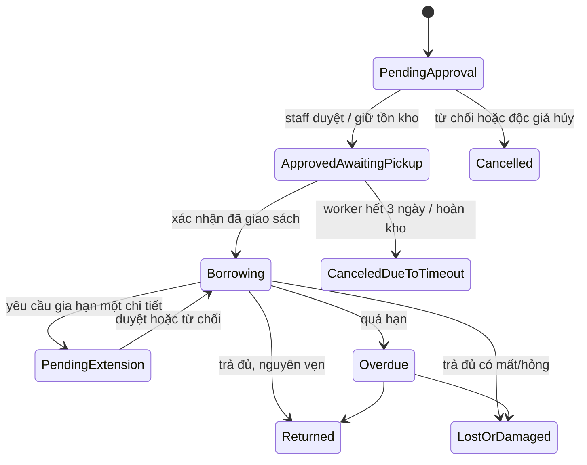
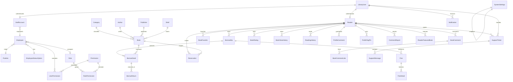

# Kiến trúc và ERD

## Quyết định chính

- Modular monolith, dependency `Web → Application → Domain`; Infrastructure triển
  khai interface của Application.
- Identity dùng `LibraryUser` (GUID). `Reader` và `Employee` là hồ sơ nghiệp vụ,
  không chứa password.
- Hai ranh giới quyền tường minh: Identity role `Reader/Staff/Administrator` kiểm
  soát vùng ứng dụng; RBAC `Role/Permission/RolePermission/UserPermission` kiểm soát
  action chi tiết của nhân viên. `StaffAccount` nối tài khoản với Employee.
- Support ticket gán cho `LibraryUser` staff, không còn FK đến Reader.
- Enum là nguồn sự thật duy nhất. Cột `Status` string cũ chỉ dùng ở bước ETL.
- Aggregate mượn/trả dùng transaction, `Idempotency-Key`, unique index và rowversion.
- Không dùng global soft-delete filter trên entity có lịch sử để tránh làm biến mất
  phiếu cũ; query catalog/admin phải lọc `IsDeleted` rõ ràng.
- Lương cấu hình bởi `Position.SalaryAmount`; tiền phạt/gia hạn/thời hạn nhận sách
  lấy từ `SystemSettings`.

## Luồng mượn

## ERD rút gọn nhưng đủ phạm vi

## Module Web

- Public/reader: catalog, book detail, favorite, comment, rating, reading progress,
  profile, borrowing, reservations, fines, notifications and support.
- Internal: dashboard, catalog CRUD, circulation, batch return, fines, reader/HR,
  roles/permissions, settings and reports.
- SignalR: `/hubs/notifications`, `/hubs/support`.
- API: `/api/v1`; write endpoint authenticated, staff/admin endpoint has policy.

## Các bước còn cần trước production

- Thêm integration test SQL Server thật và concurrency test nhiều request đồng thời.
- Bổ sung antivirus/content scanning cho upload, object storage nếu deploy nhiều node.
- Hoàn thiện payment gateway thật; endpoint hiện chỉ ghi nhận giao dịch đã xác minh.
- Bổ sung audit log bất biến cho quyền, payment, trả sách và thay đổi cấu hình.
- UAT toàn bộ màn hình CRUD sau khi nhập dữ liệu thật.
